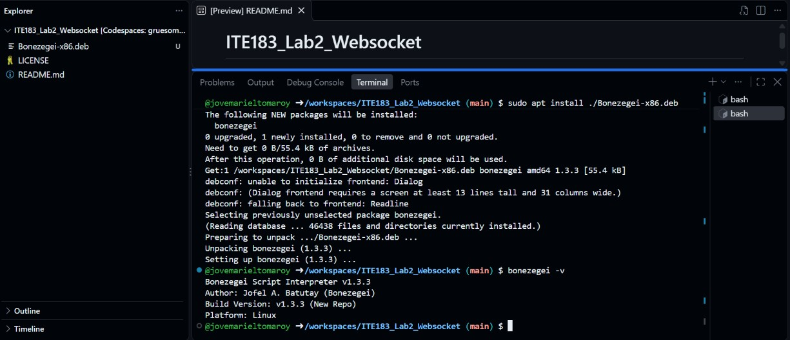
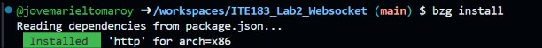
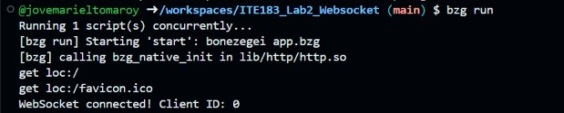
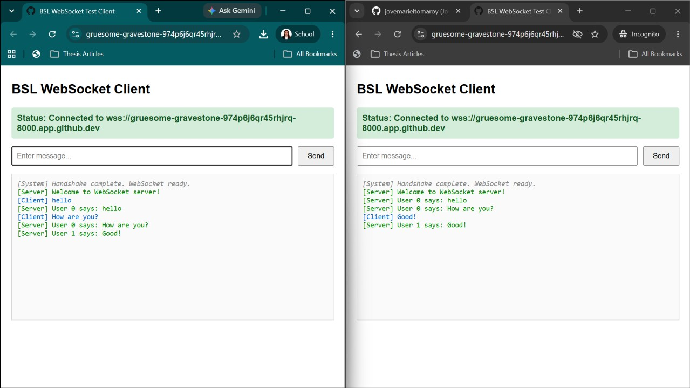
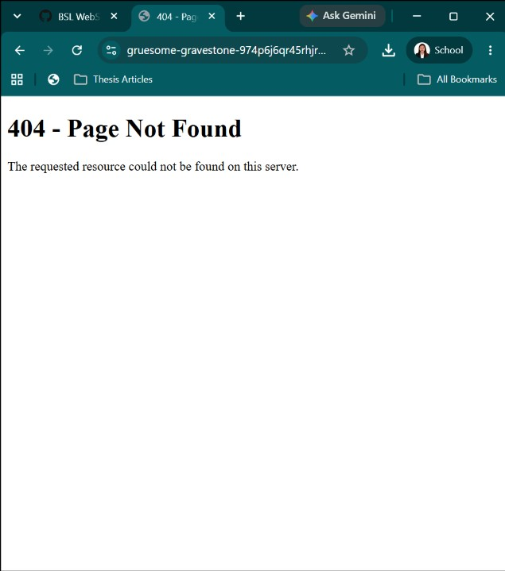

# ITE183 Lab 2: WebSocket Server (BSL Real-Time Chat)

**By:** Jove Mariel R. Tomaroy  
**Section:** IT4D.1  
**Course:** ITE183 – Web Systems and Technologies  
**Date:** October 28, 2026

A real-time, multi-client chat application developed using the Bonezegei Scripting Language (BSL v1.3.3) HTTP and WebSocket framework. The application allows multiple browser clients to connect to a server, send messages, and receive updates instantly without refreshing the page.

## Features

- HTTP server for handling browser requests
- Static file serving for the WebSocket chat interface
- WebSocket client connection handling
- Real-time message broadcasting to connected clients
- Multiple browser clients communicating simultaneously
- Connection status and chat message display
- Custom 404 page for undefined routes
- Automatic WebSocket connection using the appropriate protocol (`ws://` or `wss://`)

## Repository Structure

```text
ITE183_Lab2_Websocket/
├── app.bzg            # BSL HTTP and WebSocket server
├── package.json       # Project dependencies
├── public/
│   ├── index.html     # WebSocket chat client
│   └── 404.html       # Custom 404 error page
└── README.md          # Project documentation
```

## Prerequisites and Setup

The application uses Bonezegei Scripting Language version 1.3.3 and was developed and tested using GitHub Codespaces.

### 1. Install Bonezegei

Run the following commands in the Codespaces terminal:

```bash
wget https://github.com/bonezegei/Bonezegei_Scripting_Language/raw/refs/heads/main/Release/Latest/Bonezegei-x86.deb
sudo apt install ./Bonezegei-x86.deb
```

Verify the installed version:

```bash
bonezegei -v
```

The terminal should display Bonezegei version 1.3.3.

### 2. Install Project Dependencies

After preparing the project files, run:

```bash
bzg install
```

This installs the HTTP dependency specified in `package.json`.

### 3. Run the WebSocket Server

Start the application using:

```bash
bzg run
```

The terminal should indicate that the server is running.

### 4. Open the WebSocket Client

Open port `8000` in a browser. In GitHub Codespaces, access the application through the forwarded URL in the **Ports** tab.

Open the application in two or more browser windows to test real-time communication.

### 5. Test the Custom 404 Page

Visit an undefined route, such as:

```text
/abc
```

The server should display the custom `404 - Page Not Found` page.

> **Note:** GitHub Codespaces uses HTTPS for forwarded ports. The WebSocket client connects using `wss://` when accessed through HTTPS and `ws://` when accessed through HTTP.

## Lab Documentation

### Verification and Screenshot Deliverables

**Figure 1: Bonezegei Installation and Version Verification**

The Bonezegei package was installed in the GitHub Codespaces terminal. Running `bonezegei -v` confirmed that version 1.3.3 was installed.



**Figure 2: Project Dependency Installation**

The `bzg install` command successfully installed the HTTP dependency specified in `package.json`.



**Figure 3: Server Execution and Client Connection**

The application was started using `bzg run`. The terminal displayed the server startup process and confirmed that a WebSocket client connected successfully.



**Figure 4: Multi-Client Real-Time Chat**

The WebSocket client was opened in two browser windows. Both clients displayed a connected status, and messages sent from one window appeared in the other without refreshing the page. This confirmed successful real-time message broadcasting.



**Figure 5: Custom 404 Page**

An undefined route was opened in the browser. The server displayed the custom `404 - Page Not Found` page with the message indicating that the requested resource could not be found.



## How It Works

1. The `app.bzg` file runs the HTTP and WebSocket server.
2. The HTTP server serves the chat interface through `public/index.html`.
3. When a browser connects, the WebSocket server accepts the connection and identifies the connected client.
4. Clients can send messages through the chat interface.
5. Messages received by the server are broadcast to connected clients in real time.
6. The browser displays incoming messages without requiring a page refresh.
7. The server handles undefined HTTP routes by displaying the custom `public/404.html` page.

## Discussion

The laboratory demonstrated how a WebSocket server can support real-time communication between multiple browser clients. During testing, two browser windows successfully connected to the server and exchanged messages without refreshing the page.

The terminal also displayed client connection activity, confirming that the server was accepting WebSocket connections. Additionally, testing an undefined route displayed the custom 404 page, showing that the application could handle HTTP requests alongside WebSocket communication.

## Conclusion

Through this laboratory, I was able to set up and run a WebSocket server using Bonezegei Scripting Language v1.3.3. I successfully tested real-time message broadcasting between two browser clients and verified that the server handled both WebSocket connections and HTTP requests.

The activity helped me understand how WebSockets allow clients to send and receive messages instantly, making them useful for real-time applications such as chat systems and live notifications.
